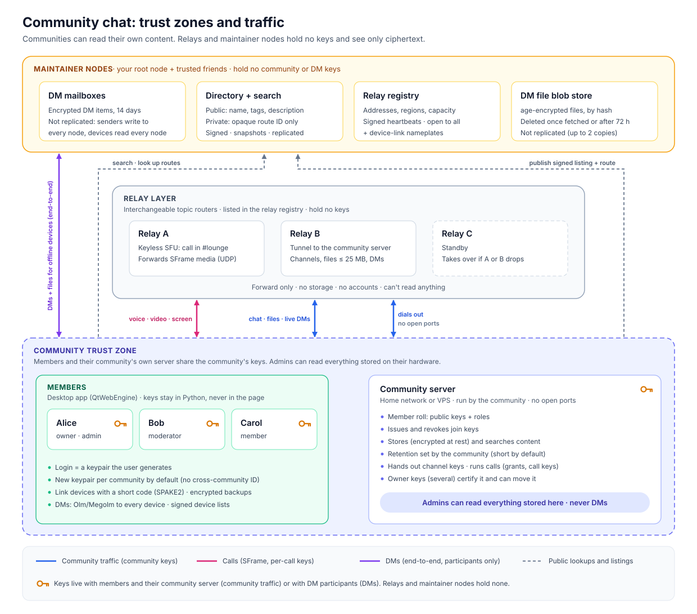

# OpenArcanum architecture

This is the high-level design. Wire formats and exact rules are in
[`protocol.md`](protocol.md), risks and controls in
[`threat-model.md`](threat-model.md), every use of cryptography in
[`crypto-inventory.md`](crypto-inventory.md), every setting and its default in
[`settings.md`](settings.md), and node configuration in
[`operations.md`](operations.md). Where those documents give a detail, they
win; this one gives the shape.

---

## 1. The short version

- **There are three trust zones.**
  1. **A community** is its members plus its own server, which share the community's keys. Admins can read everything stored on their hardware.
  2. **A DM conversation** is only its participants' devices. It's end-to-end encrypted with Olm and Megolm, and no server can read it.
  3. **Infrastructure** means relays and maintainer nodes. They hold no keys and see only ciphertext plus connection metadata.
- **Login is a keypair** the user generates. By default it's a new one per community, so there's no cross-community ID for ad-tech to join on. Keys live in an encrypted vault in the desktop app.
- **Each community runs its own server** in a home network or on a VPS. It keeps the member roll, roles and join keys, stores (encrypted) and searches content, applies its own retention, hands out channel keys, and runs calls. It only connects outward to relays.
- **Relays are interchangeable routers.** Senders publish encrypted packets to a topic and the relay forwards them to subscribers; community servers are reached through relay streams; calls go through each relay's keyless SFU. Replacing a relay means reconnecting to another one. Nothing is stored.
- **Maintainer nodes** run the community directory with search and snapshots, the relay registry, DM mailboxes, the DM file blob store, and device-link nameplates. Listings, routes and the registry replicate between them.

---

## 2. Threat model

Per-component detail: threat-model.md.

**Protects against**

- Relay operators, maintainers, hosting providers and ISPs reading any content.
- Centralized data mining. No central store of community content exists. Each community's data lives on its own hardware under its own rules, and per-community keypairs mean a person's activity in different communities isn't linked by default.
- Legal demands to maintainers or relay operators. They have directory listings, relay lists, connection metadata, and encrypted DM mailbox items and files, but no conversations.
- A stolen community server disk or backup without the storage key (everything at rest is sealed).

**Accepted by design**

- **Community admins see everything in their community:** content, files, and who did what. The client says so in the join dialog.
- **A seized or compromised running community server exposes that one community**, and only that one. Each community chooses how much history to keep, which limits the damage.
- **Relays can see who connects to what** (IP addresses, timing and volume), including who is in which call by random participant id.
- **Members can leak what they see.**
- **Anyone admitted to a public community can read it.** Revocable join keys, approval queues, member screening and short retention limit scraping.

---

## 3. Components

| Component | Run by | Holds | Can read |
|---|---|---|---|
| **Client** (desktop app: Linux, Windows, macOS) | Each member | Their identity keys and device keys, keys for channels they can read, Olm/Megolm state, an encrypted message cache | What they're permitted to |
| **Community server** | Each community | Member roll, roles, join keys, content, files, channel and call keys, all sealed at rest under its storage key; members' contact cards and one-time keys | Everything in its community; not DMs |
| **Relay** | Any registered operator | Live connections, packets in flight, call media in flight; optionally a short in-memory cache of channel envelopes | Nothing |
| **Directory + search** | Maintainers | Signed public listings; private communities as signed routes under opaque route IDs | Public listings |
| **Relay registry** | Maintainers | Relay URLs, regions, capacity, signed heartbeats | n/a |
| **DM mailboxes** | Maintainers | Encrypted items under hashed inbox addresses until fetched or 14 days | Nothing |
| **DM blob store** | Maintainers | Encrypted DM files under their hash, up to 72 h | Nothing |
| **Link nameplates** | Maintainers | Short-lived numbers pointing at a relay topic for device linking | Nothing |

---

## 4. Identity: keypairs as logins

- **The client generates a keypair.** The public key is the user's identity *to a community*, and proving they hold the private key (in a Noise handshake) is how they log in. There's no email, password or phone number.
- **New keypair per community by default.** Users can reuse one key across communities if they want to be recognizable, but the client makes that an explicit choice and shows which communities could link them.
- **Display names, nicknames, avatars and profiles are per community** and stored in that community's member roll.
- **The vault.** All keys live in an encrypted vault (scrypt + ChaCha20-Poly1305) that a passphrase unlocks. After setup the device stays signed in: it keeps the vault's key in the OS keychain (or a 0600 key file where there is none), unless the user asks for the passphrase at every start (§15).
- **Multiple devices.** A second device links with a short code typed on an unlocked device (SPAKE2 over a relay topic found through a maintainer nameplate, the Magic Wormhole design). Linked devices are equals: each holds the identity keys and makes its **own device key per community**, signed by that community's identity key. Community servers keep each member's device list (at most 5 by default), so a lost device can be removed without changing identity. Linked devices stay in sync through a private Megolm group of their own (§16.7; protocol.md §10).
- **Lost keys.** A community can't recover a lost key, but an admin can admit a new key and move the old key's roles to it (Replace member). The client reminds users to export an encrypted backup.
- **No global key directory.** Communities know their members' keys. People who want to DM find each other through a contact card published in a shared community (§9).

---

## 5. Communities

### Ownership and portability

- **Two kinds of key.** A community is identified by the founder's **owner key**. An owner key signs a **server cert** for the **server key**, which the running server uses for sessions and to sign channel events, routes and listings.
- **Several owner keys.** The founder's key starts the community's **owner set**. Any owner can add or remove owners with a signed, hash-chained owner change, so clients that pinned the founder's key can verify the current set and refuse older or forked ones (protocol.md §3.1). Any key in the current set can certify a server key. The last owner can't be removed, and the UI warns while a community has only one owner. A new owner's key is made on their own device; the server never holds owner keys.
- **Moving to new hardware.** Restore the encrypted backup with `community restore`, paste the move code, and any owner's client signs a cert for the new server key. The server then publishes its route under the same route ID. Clients check that the new key is certified by a key in the owner set, so neither a relay nor the directory can impersonate the server. Key rotation on the same hardware uses the same check.
- **Keep owner keys off the server.** They're only needed for rare operations. Each owner's key stays in their vault (copied to their own devices and backups); adding a second owner is how a community survives losing one.

### Member roll and roles

- **The server keeps the member roll:** each member's public key, devices, display name and nickname, roles, join date, and which join key they used.
- **Roles and channel permissions work like Discord's.** Ordered roles grant permissions; channels and categories override them per role or per member (allow, deny, inherit); members manage only roles below their own highest. Owners and Administrator bypass overrides. The server enforces all of it, because every piece of community traffic passes through it.
- **Feature toggles.** Admins turn features on and off per community (attachments, link previews, reactions, custom emoji, voice, video, screen share, search, contact cards, editing, deleting, typing, history for new members, join and leave messages), with some also per channel. A feature off at the community is refused by the server everywhere; otherwise the channel setting, then permissions decide (protocol.md §4.6).
- **Admin actions are signed and logged.** Role changes, kicks, bans, timeouts, toggles, retention and join-key changes are signed by the acting member's key and written to a filterable **audit log** that admins (or, if the community chooses, all members) can see.
- **Bans block a public key at the server.** Since anyone can generate new keys, bans alone won't stop a determined person. Join-key revocation, approval queues, member screening, AutoMod and rate limits are the real controls for raids. A community that runs on dedicated relays can also block a banned member's network (§10).

### Join keys

- **A join key is a random secret the server issues.** Each key records a label, who created it and when, an optional expiry and maximum number of uses, how many times it's been used, and the role(s) it grants. Creating invites needs the Create Invite permission (off for `@everyone` by default).
- **Three kinds:**
  - The community's **public join key**, shown in its directory listing.
  - **Invite links** (`openarcanum://invite/…` or a pasted code), one per person or campaign.
  - **Request-only keys**, which put the person in an approval queue instead of admitting them.
- **Revocation is immediate.** The server stops accepting the key. If it was the public key, the server publishes a new signed listing with a fresh key, or with none.
- **Raid response:** "revoke this key and remove everyone who joined with it in the last N hours." This works because the member roll records which key each person used.
- **Only the community server checks join keys.** The directory just displays what the community published.

### Private communities

Private communities never appear in search. People reach one through an invite link that contains a route ID, the community's owner key and server key (which the client pins) and a join key. The directory maps the route ID to a signed route listing the community's current relays and knows nothing else about it.

---

## 6. How community traffic is protected

- **Each member's device has an encrypted session with the server.** Each client opens a Noise `XX` session with its community server over a relay stream. The client authenticates with its device key, signed by its identity key; the server with its server key and cert, checked against the key or owner set the client pinned. Both sides negotiate the protocol version inside the handshake. The relay carries only ciphertext and can't impersonate either side.
- **Channel keys handle fan-out.** For each channel, the server generates a key and sends it, over each member's session, to members allowed to read that channel. The server publishes each event **once**, encrypted with the channel key and signed with the server key, to the channel's topic on every relay it uses, and the relays fan it out. A home server uploads one copy per message instead of one per member. Topics that can grow large commit to the server key, and the server gives each relay connection a short-lived fan-out token, so nobody else can use the relay to flood a large channel.
- **Posting goes through the server.** Clients send messages to the server over their session. The server checks permissions, slowmode, timeouts, screening and AutoMod, stores and indexes the message, then republishes it to the channel topic. Clients ignore anything on a channel topic that isn't signed by the server.
- **Keys rotate when someone loses access.** When a member is kicked, banned or loses access through a role or override, the server gives the remaining readers a new channel key **and** a new topic. The removed member can't decrypt new messages and can't even find the topic. The same happens when someone is admitted to a channel whose history is hidden from them, so a relay's cache can't show them older events.
- **Data is encrypted at rest.** Every stored row is sealed (XChaCha20-Poly1305, bound to its table, column and row): the member roll, roles, channels, join keys, audit log, settings and contact cards under the storage key; message bodies and file metadata under per-month keys. Public keys are stored only as keyed lookup hashes, and the few plaintext columns that decide access are bound to the sealed data. The search index lives in memory only. A stolen disk without the storage key reveals no names or content; admins still read everything through the running server (operations.md "Data at rest").
- **Future option.** If a community ever wants channels that even its own server can't read, end-to-end group encryption could be added on top without changing relays. Not built.

---

## 7. Messages, files, history and search

- **Messages.** Text (a CommonMark subset with code blocks and spoilers), replies, edits, deletes, reactions (Unicode and custom emoji), pins, mentions gated by permission, typing indicators and presence all go through the server and are kept according to the community's retention settings. Presence changes are batched: one update per session every 500 ms, because per-change presence flooded the server's relay connection under load.
- **Link previews** are off by default. When a community turns them on, the server (never the members) fetches the page, with strict limits against reaching private networks, and stores the preview with the message (threat-model "Link-preview fetcher").
- **Files up to 25 MB, 10 per message** (new communities start at 10 MB). The client uploads each file to the server over its session in 1 MiB chunks through the relay. The server encrypts the chunks under a per-file key and posts a message carrying that key; members download the ciphertext over their own session and decrypt it.
- **Popular files strain home connections.** One 25 MB file opened by 200 members is about 5 GB of upload from a home server. The controls are a per-community download bandwidth limit, a per-member upload quota (1 GiB a day) and a total file store limit. The relay chunk cache (§10) holds only small channel envelopes, so it doesn't help here.
- **Scrollback.** New members get history directly from the server, limited by retention, their permissions and the "new members see history" setting. Clients cache history locally (encrypted) under the same retention.
- **Search.** The server runs full-text search (SQLite FTS5, held in memory and rebuilt from the encrypted database at startup) and filters results by what the searcher may read. Each community turns it on or off.

---

## 8. Voice, video and screen share

The decision record is [voice-decision.md](voice-decision.md); the protocol is protocol.md §12.

- **Joining and keys.** To join a voice channel, the client asks its community server. If the member has Connect (and the feature is on), the server returns the call's relay, a random participant id and slot, the current call key and epoch, what the member may send, and a **grant** signed with the server key (valid at most 10 minutes; it carries no names). The call key changes on every join and leave, on every reconnect, and when the call moves relays. Each sender's SFrame key is derived from the call key and its own key id (epoch and slot), as RFC 9605 specifies.
- **Media in the webview.** Chromium inside QtWebEngine captures and processes audio (echo cancellation, noise suppression, gain control), encodes Opus with in-band FEC and VP8, and handles jitter and loss concealment. Camera is 720p30 in three simulcast layers; screen share is a screen or window, with system audio where the OS allows. Every encoded frame is encrypted with SFrame through `createEncodedStreams` before it leaves (QtWebEngine has no `RTCRtpScriptTransform`). **Only the per-call key enters JavaScript**; identity, vault, DM and channel keys never do. Python keeps the control plane (joining, keys, reconnecting).
- **A keyless SFU on relays.** Each relay can run a selective forwarding unit (Pion): one UDP port, ICE-lite, WebRTC signaling over the relay WebSocket. It admits a participant only with a valid grant, forwards each receiver the simulcast layer it asks for (switching at keyframes), and drops tracks the grant doesn't allow. It never holds keys; only the VP8 payload header stays in the clear (authenticated) so it can find keyframes. Relays bound calls, participants per address, and each participant's bitrate.
- **The community server runs the call.** It picks a relay among its attached relays that carry calls (the one with the fewest calls), and sends the relay a **signed control** listing who is muted, deafened, without video or screen share, or removed; the relay enforces it, so a modified client can't send what it isn't allowed to. It rechecks permissions after every admin action and every 10 s. Moderators can mute, deafen, move and disconnect; Priority Speaker is supported. Call media never touches the community server, so it never uses a home connection.
- **Relay failure.** A client that can't reach the call's relay for 8 s reports it; when the server loses the relay itself, or half the participants report it, the call moves to another relay with a new epoch and fresh grants.
- **No NAT trouble for clients.** Clients send media outward to the relay's public UDP port; no TURN or STUN is involved. The relay operator opens that port (operations.md).
- **Measured** (fake devices, real relay, Linux): mouth-to-ear 106 to 115 ms through a local relay and about 120 to 155 ms with emulated same-region delay and loss, under the 250 ms budget. Calls with 50 audio participants and 25 with video and screen share were run with synthetic participants. Real devices and the other OSes are covered by the manual test in [manual-tests/voice.md](manual-tests/voice.md).

---

## 9. Direct messages

**Why this is hard.** DMs can't live on a community server because they aren't community content, and relays are stateless. Some always-on node has to hold messages for offline devices, so maintainer nodes hold them, as ciphertext under addresses they can't link to people. Details: protocol.md §9, §11.

### Design

- **Encryption.** vodozemac, the Matrix Olm and Megolm implementation, used as Matrix uses it. Olm sessions between pairs of devices carry Megolm room keys; Megolm encrypts events. A 1:1 DM is a group DM with two members, so there is one code path. Only the participants' devices hold keys.
- **Identities and devices.** A **DM identity** is an Ed25519 key, one per community by default. Every device has its own vodozemac account per DM identity. The identity signs a **device list**; each device in it countersigns, so a list can't claim a device that didn't consent, and lists can't be rolled back. Every device of every member is a recipient; linking or removing a device updates the list.
- **Starting a DM.** A member can publish a **contact card** in a community (off by default per user; the community can turn cards off for everyone). The card holds the DM identity, its devices, a fallback key and a first-contact inbox per device. Devices upload one-time keys to the community server, which hands out one per device per request. Who may DM you is decided on your own devices: contacts only (default) or members of shared communities; anything else arrives as a request. Contacts can be verified with a 60-digit safety number, a changed identity key shows a warning, and blocked people's messages and invitations are dropped.
- **Groups.** Up to 10 people. The creator owns the group: rename, icon, add and remove members, transfer ownership, "members can add people", "allow attachments". The group's state is a hash chain of signed states that **every member's client checks**, since there is no server to arbitrate; invitees must accept; concurrent changes resolve the same way on every client (the owner's change first, else the lower hash). New members can't read messages from before they joined.
- **Rotation.** A sender starts a new Megolm session when the set of recipient devices changes, after 100 messages, and after 7 days.
- **Delivery.** Every event goes both live, on the group's relay topic (a random value chosen by the group's creator and carried in the signed group state), and into each recipient device's mailbox inbox for that group. Olm messages (room keys, invitations) go to mailboxes. Typing is live only. Duplicates are dropped by event id.
- **Files.** Up to 10 per message, 25 MB each. Each file is encrypted on the device with a fresh key as an age v1 payload; the key and the ciphertext's hash travel inside the Megolm event, with a thumbnail made on the sender's device. The sender streams the ciphertext live on the group topic; for devices that didn't confirm within a few seconds it uploads the ciphertext once to the **blob store** on up to two maintainer nodes, with one random fetch token per device. A blob is deleted when every token is released or after 72 hours; after that, recipients see "expired".
- **Not built.** Contact links (a contact card shared outside a community) and replacing a first-contact inbox. DMs start from a card in a shared community.

### Mailboxes

- **Write to every cluster, read every node.** A client drops each item into every independent maintainer node it uses and into each maintainer cluster (two healthy members), and a device reads every node, handling each item once (by a global id it computes from the item) and deleting it from its node only after it was handled. Independent nodes don't replicate mailboxes, because that would only spread copies of who writes to which inbox. The members of a maintainer cluster (nodes run by parties who trust each other, under one signed member list) replicate items and deletes both ways, and clients read every member because one may lack what another has. An item is lost only if every node that held it loses it, or a device stays offline past the 14-day lifetime (protocol.md §7.1 and §7.5 cover each failure case).
- **Inbox addresses** are SHA-256 hashes of a random token only the recipient device holds, and they're per conversation and per device, so nodes can't tell who is talking to whom from what they store. Only the token holder can fetch or delete; dropping needs nothing, so senders aren't identified to the node. Nodes still see IP addresses and timing.
- **Limits** (maintainer settings): 14-day lifetime, 100 MiB per inbox, items up to 2 MiB, a drop rate per inbox, a daily byte budget per client network, and a total store limit. First-contact inboxes are the spam surface; the per-inbox rate limit and quota bound them. Files don't go through mailboxes but through the blob store (72 h, per-network quotas, a total store limit).
- **Several node lists.** Users can change which maintainer nodes they use. Sender and receiver need at least one node in common; the built-in list gives everyone the same set.

### Alternatives considered

| Option | Problem |
|---|---|
| Live-only DMs (both people online) | Desktop apps are closed for long stretches, so messages would rarely arrive |
| Sender's device keeps retrying | Same problem, and the sender has to stay online |
| Storing on relays | Relays would no longer be simple and replaceable, and a relay going away would lose mail |
| Storing on a shared community server | Puts DMs on a community's hardware, where its admins have visibility |
| MLS (RFC 9420) | No usable Python binding |
| Replicating mailboxes between all maintainers | Adds copies of who writes to which inbox to nodes the user doesn't trust; only members of one trusted cluster replicate (protocol.md §7.5) |

---

## 10. Relays

- **The job:** route encrypted traffic. A relay offers three things: **publish/subscribe on topics** (channels, live DMs, device sync, live DM files); **a byte stream to an endpoint that registered a key**, which is how a client reaches its community server; and, if enabled, **a keyless SFU for calls** (§8). Messages are limited to 25 MB and sent in chunks. Relays keep no disk storage, no user accounts and no keys, and can't read what they carry. They speak WebSocket (`/ws`) plus UDP for call media; WebTransport isn't built.
- **Knowing a topic is the permission.** Topics are unguessable random values handed out by community servers or carried in signed DM group states. A community server's endpoint registration is signed over the relay's per-connection nonce, so knowing a route doesn't let anyone hijack it.
- **Abuse limits** (operations.md "Abuse controls"):
  - per-connection frame and byte rates, send-queue limits that drop slow subscribers, and caps on subscriptions, streams and connections;
  - **proof-of-work** (Hashcash with SHA-256, bound to the connection's nonce) for new connections while the relay is under load, and a bounded number of connections that haven't started yet, per network and in all;
  - **fan-out tokens**: publishing to a topic with more than 100 subscribers needs a short-lived token signed by the key the topic commits to (the community server), checked without storing anything per user;
  - a per-stream budget for connections that host a community server, so a busy community isn't throttled as one client;
  - call limits: calls, participants, participants per address, bitrate per participant, and optionally only calls from listed community servers.
- **Optional chunk cache.** Off by default. An operator can let the relay keep recent channel envelopes (already encrypted and signed) in memory for a short time, so members who reconnect catch up. Streams, files and call media are never cached.
- **Interchangeable.** Each community server stays connected to its relays (pinned, or two picked from the registry automatically) and lists them in its signed route. Clients can use any listed relay. In automatic mode a relay that fails is replaced at once by a healthy one from the registry and the route is republished; pinned and dedicated relays never move. Clients look the route up again after a failed round, and calls move to another relay. Since nothing is stored, nothing is lost except packets in flight.
- **Registration.** Relays send signed heartbeats (URL, region, capacity, load) to the registry on the maintainer nodes; registration is open, and maintainers can remove a relay's whole host. A malicious relay can drop or delay traffic and watch timing, but it can't read, forge or replay content, because everything is encrypted and signed.
- **No inbound ports for communities.** Community servers and clients connect outward to relays, so community servers need no port forwarding. A relay needs its WebSocket port and its media UDP port.
- **Dedicated relays (opt-in).** A relay operator can dedicate a relay to one community server (configured with its key). It then carries only that server's streams, channel topics and calls, doesn't register with the maintainers, and takes signed moderation commands from that server: block the networks (IPv4 address, IPv6 /64) behind some of its session streams, or lift such a block. A community pinned to such relays only can therefore ask for a network block with a ban. The server never learns an address (it names streams and keeps an opaque block id), and the relay keeps its block list in one file, the only thing it writes. It is still keyless and reads nothing it carries; what it gives up is being an interchangeable router for that community. Shared addresses (CGNAT, VPN, Tor) are blocked together, and the block is easy to evade: a speed bump on top of key bans, not a replacement.

---

## 11. Public directory and search

- **What a listing contains:** name, description, tags, language, a member-count range, the icon's hash (the icon travels beside the signed bytes), join policy (open, request or invite-only), the current public join key if there is one, the server's public key, and current relays. The server key signs the listing and carries a cert from the community's owner set, so maintainers can't change it. They can only accept, refuse or remove it.
- **Search** works by name, tags and description on the maintainer nodes. It needs no account, and nodes don't log queries. With "Search the directory on this device" on, the client downloads the **directory snapshot** page by page, verifies every listing, and searches locally, so no maintainer sees its queries.
- **Replication.** Maintainer nodes pull listings, routes and relay heartbeats from their peers and re-verify everything, so any of them can answer searches and route lookups. Routes and listings are ordered by owner set first, then sequence number. Mailboxes and blobs replicate only inside a maintainer cluster (§9).
- **Status and reaping.** Community servers send a heartbeat signed with the server key every minute. Maintainers show a community online, degraded or offline from it, and a community silent for longer than `community_reap_after` (7 days) is ended: its route, listing and status go, and a tombstone stays for `community_tombstone_ttl` (30 days). Coming back needs an explicit `community reregister` (protocol.md §7.4).
- **Spam control:** a per-community limit on listing updates, a per-network write limit on every write endpoint, and the maintainers' delisting (`meta directory delist`). Proof-of-work for listings and user reports of listings aren't built.
- **The directory is off by default** on a maintainer node (`directory_enabled`); joining then relies on invites shared elsewhere.
- **Private communities** never appear in search. The directory only maps their opaque route ID to a signed route.

---

## 12. Retention and storage costs

- **Each community sets its own retention**, separately for messages and files, and channels can set their own. The default is 30 days for messages and 7 days for files; anything up to keeping data forever is allowed.
- **Clients follow the same setting** for what they cache locally, and drop purged messages from the open view.
- **Purging** deletes data from the server's database and search index. Message bodies and file metadata are sealed under the key of the calendar month they were created in, and a month's key is deleted once the whole month is past the longest retention in effect, so expired data is unreadable even in an older copy of the database (unless that copy also holds the key). SQLite runs with `secure_delete`.
- **Rough costs**, assuming about 1 KB per stored message including metadata, and an average file size of 2 MB:

| Community | Text per year | Files per year | Verdict |
|---|---|---|---|
| Small hobby group: 50 members, 500 messages and 10 files a day | ~180 MB | ~7 GB | Can keep everything forever on a Raspberry Pi |
| Active: 500 members, 5,000 messages and 200 files a day | ~1.8 GB | ~146 GB | Keeping text forever is trivial; files need a retention limit or a large disk |
| Large: 5,000 members, 50,000 messages and 2,000 files a day | ~18 GB | ~1.5 TB | Needs a VPS or NAS, and short file retention |

The search index is held in memory and is roughly the size of the text it covers. **Long text retention and search are cheap; files are the real cost**, which is why they get their own retention setting and a store limit (`file_store_max`, 20 GiB by default). Home upload bandwidth is a bigger constraint than disk space (§7). Load tests (load-tests.md) show a community server handling 5,000 members, 500 online and 50 messages a second on two cores with well under 4 GB of memory.

---

## 13. Who sees what

| Party | Sees | Doesn't see |
|---|---|---|
| Community admins / server | All community content and files, the member roll, activity, who is in calls; members' contact cards and who asked for whose card; link-preview fetches | DMs; call media; other communities; statuses' custom text unless shared with the community |
| Members | Channels their roles allow; the member list | Channels they can't access; DMs they're not in |
| Relays | IP addresses, timing, traffic volume, topic IDs; call participants by random id, packet sizes and timing | Any content; who owns a key; participants' names |
| Directory | Public listings, search queries (no accounts, not logged), route lookups, snapshot downloads | Content; private community details; queries of users who search locally |
| DM mailboxes | Hashed inbox addresses, item sizes, drop-off and fetch times and IPs | DM content; who sent it; whose inbox it is |
| DM blob store | Ciphertext sizes, upload and fetch times and IPs, how many devices a file is for | File content, names and recipients |
| Maintainers | Whatever their own nodes see (above) | Any content |
| Update host | Each update check's IP address and time (the request carries no identifier) | Anything else; checks can be turned off |
| Ad-tech / scrapers | Public listings, and more only if admitted to a community | Everything else |

---

## 14. Moderation and abuse

- **Community admins fully moderate their own community.** They can read everything, so moderation runs on their server: kick, ban (optionally deleting recent messages), timeouts, bulk delete, member screening by membership age, AutoMod (keyword, regex, mention-spam and link rules; block, alert or time out), a report queue, and the audit log. Every rule is enforced by the server, with the role hierarchy (protocol.md §4.7 to §4.9).
- **Maintainers moderate only their own services:** the directory (delisting), the relay registry (removing relays) and the blob store, with the maintainer admin CLI, plus rate limits and quotas on mailboxes and blobs. The policy for removing directory listings is the maintainers' to write.
- **DMs.** Blocking and the DM policy work on the recipient's own devices; group invitations always need accepting; communities can turn off member contact cards. There's no in-app DM report flow: what a person received is theirs to share.

---

## 15. The desktop client

- **pywebview on QtWebEngine** on every OS. Python holds every key and network connection on a background thread; the UI is plain HTML, CSS and JavaScript with a strict content security policy, no remote content and no webview storage (§16.6, §17; threat-model "Webview"). The engine is used directly only for calls (§8). Keeping keys in Python keeps them out of the browser engine.
- **The vault** is unlocked with a passphrase; after an idle timeout the client locks (open sessions keep running). **Staying signed in** is the default after creating, restoring or linking a profile: the vault's key (never the passphrase) is kept in the OS keychain (Windows Credential Manager, macOS Keychain, Secret Service) through Python's `keyring`, or, where no keychain exists, in a 0600 key file in the config folder, with the trade-off stated in Settings → Security. "Ask for my passphrase when OpenArcanum starts" turns it off; a lock deletes the key until the passphrase is entered again.
- **Native notifications:** the freedesktop notification service on Linux, Qt's tray notifications on Windows and macOS; only "New activity" while locked.
- **Installers:** a Linux AppImage, a Windows installer (Inno Setup) and a macOS `.dmg` (Apple silicon), built by CI, and signed and notarized when the signing secrets are configured ([packaging.md](packaging.md)).
- **Auto-update:** the client checks a release manifest signed with an offline Ed25519 release key, verifies it before parsing, checks each download's size and hash, and installs only after the user agrees. A build without a release key never checks ([release.md](release.md)).
- **Invite links** (`openarcanum://invite/…`) only prefill the Join dialog.
- **Hosting.** The app bundles the `community` server and can run communities from the profile's data folder (§16.4).
- **Crash logs** stay on the device, with no telemetry and no message content.

---

## 16. Client flows

There are no accounts, so "logging in" means two separate things:

- **Unlocking the local profile:** opening the encrypted vault on this device that holds all your keys.
- **Authenticating to a community:** a Noise handshake that proves you hold a key on that community's member roll. This happens every time the client connects.

### 16.1 First run and unlock

1. **Create a profile.** On first launch the user picks a passphrase (with a minimum length and a strength meter), or takes a generated one: six words from the EFF large wordlist, drawn in Python (`passgen.py`), about 77.5 bits. The client creates an empty vault in the data directory (§16.6): keys, joined communities and profile settings, encrypted with ChaCha20-Poly1305 under a key derived from the passphrase with scrypt.
2. **Unlock.** After creating, restoring or linking a profile, the device **stays signed in**: it keeps the vault's key (in the OS keychain where there is one, else in `unlock-key`, mode 0600, in the 0700 config folder; `keychain.py`), and the next launch opens without the passphrase. Settings → Security → **Ask for my passphrase when OpenArcanum starts** (off by default; needs the passphrase) deletes the key and re-keys the vault, and every launch then asks. A `preferences.toml` without the setting keeps asking until the user accepts a one-time offer after a passphrase unlock ("Stay signed in on this device?": **Stay signed in** or **Keep asking**). The vault is decrypted in memory only. After each wrong attempt the client waits a little longer before allowing another.
3. **Forgot passphrase.** There is no reset. The client offers three ways on:
   - link again from another device that's still unlocked (§16.7), since each device has its own passphrase;
   - restore from a backup file (§16.5);
   - start a new profile. The old communities would then need their admins to re-admit the user. The old vault is moved aside (renamed, not deleted), so a remembered passphrase can still recover it.
4. **Lock.** The client locks itself after the idle timeout, and there's also a "Lock now" button. Locking hides the UI and clears identity keys from memory; the vault's file key stays in memory, so sessions that are already open keep running and state that arrives is still saved. Locking also deletes the key kept for staying signed in, so a locked profile needs the passphrase to come back, also after a restart; the passphrase then keeps the key again (unless the device asks at every start).

### 16.2 Joining a community

1. **Find it** through directory search, an invite link, or a pasted invite string. Opening a `openarcanum://invite/…` link starts the app (or brings the running one to the front) with the Join dialog prefilled once the profile is unlocked; the user still goes through steps 2 to 4 (`instance.py`).
2. **Preview.** The client looks up the community's route and connects through a relay, checking the server key it pinned from the listing or invite. It then shows the name, description, member-count range and join policy, and the notice *"Admins of this community can read everything you post here"* (§2).
3. **Choose an identity.** By default the client creates a new keypair. The user can instead reuse an existing identity; the client then lists which communities would be able to link them. The user also sets a display name.
4. **Submit.** The server answers **admitted**, **pending approval** (shown until an admin decides), or **refused** (the key was revoked or expired, the user is banned, or the community is full).
5. **Admitted.** The server sends the member's roles, the channel list, channel keys and topic IDs, and the client loads history.
6. **Backup reminder.** The client shows "Your backup is out of date" until the user exports a new one.

### 16.3 Reconnecting

- After every unlock, the client opens a session to each joined community using that community's key. The server checks the member roll on every handshake.
- Joins that are still pending are checked again on reconnect.
- If the server reports the member as removed or banned, the client marks the community as removed, stops reconnecting and deletes its local copy of that community's data.
- The same key can be in use on two devices at once, so the server allows several sessions per key.

### 16.4 Creating a community

**Add a community** is a page with four ways in: Join with an invite, Find a community (§16.2), **Host on this computer** and **Host on your own server**.

**Host on this computer** (the default way to create one): the app ships the `community` server (`servers/` in the bundle, `bin/community` from source; `hosting.py`). It runs `community init -automatic-relays` into `<data>/hosted/<id>/server/` (mode 0700) with this device's maintainer nodes and seed relays (the preferred relays, then the registry's least loaded), starts `community run -stop-with-stdin` as a child process, and claims it through steps 2 and 3 below with no code to copy (the claim code goes through a 0600 file the server deletes once claimed). The community's record in the vault names the folder. The child runs while the app runs, also when locked or closed to the tray. It is started again after 1, 2, 4 … 60 s when it exits; stopped cleanly on Stop (remembered), Quit (closing its stdin, so it tells the maintainers it is going offline) and a data folder move; and it stops by itself if the app dies, because its stdin closes. A child process rather than an in-process server keeps it the same program operators run, and `-stop-with-stdin` ties it to the app's lifetime on every OS without platform process APIs. Its log is `<log>/hosted/<id>.log`. Quitting while hosted servers run asks first. A hosted community is offline while the app isn't running; maintainers reap it after `community_reap_after` (7 days) and **Bring it back online** runs `community reregister` (protocol.md §7.4).

**Host on your own server:**

1. The operator runs `community init` on the server machine (the page saves the bundled program for this computer's system and shows the commands). This generates the server key and prints a one-time **claim code** containing the server's public key, its route and a secret.
2. In the client, **Host on your own server**, then paste the claim code. The client generates an owner key in the vault and uses it to sign the server key. The server records the owner.
3. A setup wizard asks for the name, description, tags, public or private, join policy, retention and maximum file size. The server then creates `#general` and a first invite, and publishes a signed listing if the community is public.
4. The client asks the owner to export a backup right away and to add a second owner. Until a second owner exists, Community settings → Ownership and a banner above the chat warn: "If you lose your owner key, nobody can rotate the server key or move the community. Add a second owner."
5. **Adding an owner.** An owner picks a member in Community settings → Ownership and invites them. The member's client shows the invitation; on **Accept** it generates a new owner key on that device and sends only the public half, signed by the new key and by the member's key. An owner then **Confirms** it: their client signs the owner change and a new server cert under the changed owner set. No private key ever leaves the device that made it; the new owner's other devices receive a copy through device sync, and backups include it.
6. **Removing an owner.** Any owner can remove another owner, or themselves while another owner remains. The last owner can't be removed. A removed key can't sign certs or owner changes again, and the removed owner's client deletes it. Owners can't be kicked or banned and can't leave while they are owners.

### 16.5 Leaving, backups and devices

- **Leave.** The client tells the server, deletes that community's local data, and by default deletes its key.
- **Export backup.** An encrypted file protected by its own passphrase. It holds every key and the list of joined communities (routes and pinned server keys), but no message history.
- **Restore from backup.** On first run, "Restore from backup" sets up the profile from a backup file. It's the fallback when no other device is available; the normal way to add a device is linking (§16.7). A restored device generates its own device keys, like a linked one.
- **Lost everything.** The user rejoins with a new key, and an admin uses **Replace member** to move the old key's roles to the new one.

### 16.6 Where the client stores data

**Nothing is stored in the webview.**

- UI code never uses `localStorage`, `sessionStorage`, IndexedDB or cookies; `openarcanum/guard.py` fails `make check` if it does.
- The window is created with `private_mode=True`. That's pywebview's default, but it's set explicitly so a library change can't flip it. `storage_path` is never set.
- Anything the UI needs to keep, such as the open channel or a message draft, goes through `window.pywebview.api` to Python.

**Python writes to the OS app directories** through `platformdirs`. `paths.py` is the only module that works out these paths.

| Directory | `platformdirs` function | Holds | Encrypted? |
|---|---|---|---|
| Config | `user_config_dir` | `preferences.toml`: theme, text size, window size and position and the other per-device settings ([settings.md](settings.md)). `unlock-key`: the vault's key, only where there is no OS keychain and while the device stays signed in | No. `preferences.toml` holds nothing sensitive, so the lock screen can read it before unlock. `unlock-key` opens the profile for anyone who can read the user's files (Settings → Security says so); it is here, not in the data folder, so a copy of the data folder stays locked |
| Data (AppData on Windows) | `user_data_dir` | `vault.bin`: keys, joined communities, profile settings. `state.bin`: drafts, last-open channel, read markers and other UI state. `olm.bin` and `dms.bin`: DM keys and history. `hosted/<id>/`: communities hosted on this computer (§16.4), each a community server's data directory (`server/`) and `host.json` | Yes. The vault uses the passphrase key; the other files use keys kept in the vault. A hosted server's data is encrypted at rest by the server with the storage key beside it, as on any server, because it must run before unlock |
| Cache | `user_cache_dir` | Message history and downloaded files, kept only as long as each community's retention allows | Yes, with a key kept in the vault. Safe to delete |
| Logs | `user_log_dir` | Logs with IDs and sizes only | No. Never contains message content, keys or passphrases |

Typical locations are `~/.config/OpenArcanum`, `~/.local/share/OpenArcanum` and `~/.cache/OpenArcanum` on Linux, `%LOCALAPPDATA%` on Windows, and `~/Library/Application Support` and `~/Library/Caches` on macOS. The folder name comes from `PRODUCT_NAME` in `openarcanum/__init__.py`.

- Writes are atomic (write a temp file, then rename it), so a crash can't corrupt the vault.
- On Linux and macOS, directories are created with mode `0700` and files with `0600`.
- The config file never holds anything that identifies a person or a community, because it can be read before unlock.
- `--home DIR` puts all four directories under `DIR`, for tests and for running two clients side by side.

### 16.7 Linking a second device

**Device model.** Every linked device holds the identity keys, so devices are equals and losing one never strands the user. Every device also has its own **device key** per community: the Noise static key is a per-device key, signed by the community identity key. Community servers keep each member's list of device keys, which is what makes "Remove device" possible. The alternative, a primary device that alone holds identity keys, would limit the damage from a stolen linked device but force an admin to re-admit the user everywhere if the primary were lost.

**Linking steps**

1. **The new device starts.** On first run the user picks **Link to an existing device**. The new device generates a temporary keypair used only for this link, and asks a maintainer node for a short-lived **nameplate**, a random six-digit number that points to a fresh relay topic (Magic Wormhole's mailbox idea). The new device has no settings yet, so the link screen lets the user name maintainer nodes (default: the built-in list). It shows a code made of the nameplate plus three random words, such as `42-purple-sausage-anchor`, with a 5-minute countdown.
2. **The existing device enters the code.** On an unlocked device, the user goes to **Settings → Devices → Link a new device** and types the code.
3. **Secure channel.** Both devices meet on the relay topic and run SPAKE2, a password-authenticated key exchange, using the code. If the codes match, both devices end up with the same strong key. Someone who doesn't know the code gets one guess, and a wrong guess cancels the link. The relay and the maintainer node never see the code or the key.
4. **Approve.** The existing device shows the new device's name and asks the user to approve, with the warning *"Only continue if you are setting up your own device right now. Never enter a code someone sent you."* Nothing is sent until the user approves.
5. **Choose what to share.** The existing device shows which communities will be shared (all by default; a community can be kept on one device only) and which message data to copy (below), with sizes.
6. **Transfer.** The existing device sends the chosen identity keys, the community list (routes and pinned server keys), user settings and the device-group key, encrypted under the shared key and sent through the relay in chunks under its 25 MB limit.
7. **Finish on the new device.** The user sets a passphrase for this device's vault (each device has its own) and names the device. The new device makes its own device key for each community, signs it with that community's identity key, and connects. Each community server adds it to the member's device list.
8. **Notify.** Every other device the user owns shows "New device linked: <name>".

**Copying message data (optional)**

- **Direct messages: on by default.** The user's devices hold the only copy of DM history, so this is the only way to get old DMs onto the new device. The new device is also added to each DM group as a new device, so it receives future DMs; it gets no Megolm keys for messages sent before it was added, which come only from the history copy.
- **Downloaded community messages and files: off by default.** The new device can fetch anything still within each community's retention from the community server, so copying only saves download time. Copied data still follows each community's retention.
- **The copy runs in the background** after setup, so the new device is usable right away. It resumes if interrupted, but the existing device has to stay online until it finishes.

**Keeping devices in sync**

- Linked devices share a **device-group key** and a private sync topic. When something changes on one device, it sends a small encrypted event to the others: joined or left a community (with keys), settings changed, device linked or removed.
- Devices that are online get events live through a relay. Offline devices pick them up from a mailbox on the maintainer nodes, the same service DMs use (§9).
- If two devices change the same setting, the latest change wins. Joined communities and keys from different devices are combined.
- Messages aren't synced this way. Each device gets them directly from community servers and DM groups.

**Removing a device**

- **Settings → Devices** lists each device with its name, the date it was linked, and when it was last seen.
- **Remove** sends every community a revocation signed with the identity key, so servers refuse that device's key. It also replaces the device-group key. If the removed device is online, it wipes its vault.
- A lost device is protected by its passphrase, because its vault is encrypted on disk. If the passphrase might also be known, the user should replace their identity in each community (an admin uses **Replace member**, §16.5), since the lost device held the identity keys.

**Security notes**

- A code works once, expires after 5 minutes, and allows only one guess. Three words give more margin than Magic Wormhole's two, since the code unlocks credentials.
- The existing device must be unlocked, and the user must approve on it.
- Maintainer nodes see only that a nameplate was used, and from which IP addresses. Relays see only ciphertext.

---

## 17. How the client uses pywebview

The desktop client is Python + pywebview on the Qt backend (PySide6 +
QtWebEngine) on every OS, so the engine is Chromium everywhere. A few rules
about how pywebview is set up are easy to break without noticing, and some of
them only show up as a hang at exit.

**The UI loads as a `file://` URI.** `app.py` passes `FRONTEND_INDEX.as_uri()`
to `webview.create_window`. pywebview treats any URL that isn't `http://`,
`https://` or `file://` as a local path and serves it with its own HTTP server
on a loopback port. A real `file://` URI skips that server, so the app opens
no listening socket and the page loads straight off disk, in development and
inside the PyInstaller bundle alike. The cost: no `fetch()` of sibling files
and no ES module imports, so the UI is plain scripts loaded by `index.html`.
Everything it needs from outside the page comes through the bridge. The
window never leaves the app's own page (`harden_webview`).

**The bridge exposes explicit methods and never blocks on the GUI thread.**
pywebview exposes only the methods defined on the `js_api` object
(`api.py`, `JsApi`) as `window.pywebview.api.*`; each returns a Promise in
JavaScript, and the page can call only JsApi's public methods
(`api.install_bridge_guard`). pywebview runs every call on a thread of its
own. A bridge method only ever waits on the core's asyncio loop (with a
timeout), never on the Qt main loop. Anything that needs the GUI thread (file
dialogs, the clipboard, DevTools) is handed to the main thread and answered
later through a bus event. The CSP allows `'unsafe-eval'` because pywebview's
injected bridge evaluates strings; inline scripts stay blocked. The UI's
scripts use plain globals (`st` and the helpers in `ui/js/app.js`), so they
can be inspected and called from DevTools.

**Every thread is a daemon, and only the bus sender calls `evaluate_js`.**
Four facts combine into a silent hang at exit:

1. pywebview starts each bridge call on a non-daemon thread.
2. pywebview's Qt backend handles Ctrl+C by quitting the Qt application. The
   event loop stops at once; window close handlers don't run.
3. `window.evaluate_js` posts the script to the Qt main loop and then waits,
   with no timeout, for the loop to report the result. If the loop has
   stopped, the wait never ends.
4. When the main thread returns, CPython joins every non-daemon thread before
   it runs `atexit` handlers. One thread stuck in step 3 keeps the process
   alive.

pywebview also hands each bridge call's return value back to the page with
`evaluate_js`, so even a call that finishes after the window is gone (one
that closed it, such as "Restart and install") gets stuck the same way. So:

- Only the bus sender in `bus.py`, a daemon thread draining a FIFO queue,
  calls `evaluate_js`. Everything else enqueues and returns at once, so a
  bridge thread never blocks on the GUI loop, events stay in order, and a send
  stranded by shutdown can't keep the process alive. It also avoids calling
  `evaluate_js` from the Qt main thread, which would deadlock.
- Every thread the client starts is a daemon, and so are pywebview's bridge
  threads: `daemon_bridge_threads()` in `app.py` swaps the `Thread` class
  pywebview uses.
- On the way out, `run()` saves everything through `core.shutdown()`, bridge
  calls still waiting on the core get "closing" at once, and the interpreter
  exits normally.
- `tests/test_app.py::test_bus_push_never_blocks_exit` and
  `test_bridge_call_left_returning_to_a_closed_window_does_not_block_exit`
  check this; `tests/test_shutdown.py` covers the rest of shutdown.

When a process hangs at exit with no output, suspect a non-daemon thread
being joined during interpreter shutdown first.

**DevTools are local, and never `debug=True`.** `webview.start(debug=True)`
turns on QtWebEngine's remote debugging port, whose inspector front end is
loaded from a Google-hosted page. The client never passes it (`guard.py`
fails `make check` if it does). Instead, when the app is started with
`--debug` or `OPENARCANUM_DEVTOOLS=1`, Ctrl+Shift+I (Cmd+Shift+I on macOS)
opens Chromium's bundled DevTools in a sibling Qt window: a second
`QWebEnginePage` attached with `setDevToolsPage` (`_attach_devtools` in
`app.py`), on an off-the-record profile so it stores nothing. The key is
caught both by a Qt shortcut and in JavaScript (`ui/js/bridge.js`), because
the web view swallows most key events. `--debug` also opens DevTools at start.
Without either, the shortcut does nothing. Qt objects are created on the main
thread, reached through pywebview's `create_window_trigger` signal.

---

## 18. Building blocks

| Area | Choice | Notes |
|---|---|---|
| Servers | Go, standard library first (`net/http`, `log/slog`, `crypto/ed25519`); public HTTP(S) servers share `internal/httpx` (`gorilla/mux`, `gorilla/handlers`) | One module and a few small binaries |
| Relay transport | WebSocket: `github.com/coder/websocket` (Go), `websockets` (Python) | WebTransport isn't built |
| Wire format | Protocol Buffers in `proto/openarcanum/v1`, generated for Go and Python | One schema for two languages |
| Identity | Ed25519 | Logins, admin actions and directory listings are all signatures |
| Sessions | Noise `XX` (`Noise_XX_25519_ChaChaPoly_SHA256`): `flynn/noise` (Go), `noiseprotocol` 0.3.1 vendored as `openarcanum._vendor.noise` (Python). The handshake payload carries the Ed25519 identity key and its signature over the Noise static key | No maintained Python Noise library exists, so the last `noiseprotocol` release is vendored as-is (`_vendor/noise/VENDORED.md`). Both sides run the cacophony and snow test vectors, Go and Python interoperate in tests in both directions, and both frame decoders are fuzzed |
| Device linking | SPAKE2 (`spake2`, the package Magic Wormhole uses) with a short typed code, over a relay topic found through a maintainer nameplate | Desktops can't easily scan QR codes; both ends are Python |
| Channel and call keys | Server-issued symmetric keys, ChaCha20-Poly1305 per message; SFrame (RFC 9605) for media | §6, §8 |
| DMs | vodozemac (Olm and Megolm) through its Python bindings; DM files as age v1 payloads | §9 |
| Media | WebRTC in QtWebEngine with SFrame in JavaScript (AES-GCM and HMAC from the engine's WebCrypto); Pion for the relay SFU | §8; crypto-inventory.md explains the WebCrypto use |
| Other primitives | Only `cryptography` (Python) and the Go standard library and `x/crypto`; `filippo.io/age` for community backups | crypto-inventory.md |
| Server storage | SQLite via `modernc.org/sqlite` (pure Go, no cgo), FTS5 for search | One file per community; easy backups |
| Client runtime | Python + pywebview on the Qt backend (`pywebview`, `pyside6`, `qtpy`) | §17 |
| Client storage | `platformdirs` for the OS app directories; an encrypted vault (scrypt, ChaCha20-Poly1305); `keyring` for staying signed in | §16.6 |
| UI | Plain HTML, CSS and JavaScript in `clients/shared/ui/`, no bundler or build step | JS calls Python through `window.pywebview.api`; Python pushes events with `evaluate_js` |

---

## 19. Running the servers

Details: operations.md and admin-guide.md.

- **Release builds.** Static binaries for linux/amd64 and linux/arm64 (Raspberry Pi), container images on a minimal base, and hardened systemd units. `community init` has a guided setup for a home network or a VPS; the community server needs no inbound port.
- **Backups.** Community servers write `.fbk` backups on a schedule: an age file (scrypt recipient over the storage key) of a live database snapshot, streamed in bounded memory. `community restore` stages everything and never replaces an existing storage key. Maintainer nodes write a consistent tar backup (database plus blob files, with a manifest); a restore moves mailbox ids forward and changes the mailbox epoch so clients don't skip new mail. Relays keep nothing to back up.
- **Upgrades.** Databases migrate step by step on start; a database written by a newer release is refused untouched. Protocol versions are negotiated on relays, sessions and the maintainer API, which accept the current and the previous version (protocol.md §1).
- **Logs.** Text or JSON, never content, names, keys, tokens, inbox addresses or queries; members and devices appear as short fingerprints. Rotated by journald or the runtime, or by the node itself when it writes a file.
- **Health and metrics.** An optional status listener (off by default, meant for loopback) serves `/healthz`, `/readyz` and Prometheus metrics that are counts and sizes only.
- **Maintainer admin CLI.** Delist communities, remove relays, inspect and purge the blob store, manage cluster membership.
- **Load tests** (load-tests.md) met every target: a community server with 5,000 members, 500 online and 50 messages a second; a relay with 2,000 connections; a maintainer node with 10,000 listings and search p95 of 37 ms.

---

## 20. Source layout and tests

### Layout

| Path | What |
|---|---|
| `cmd/relay`, `cmd/community`, `cmd/meta`, `cmd/site` | The node binaries: relay, community server, maintainer node, project website |
| `internal/` | Go packages: `relay`, `sfu`, `community`, `meta`, `site`, `session` (Noise), `identity`, `atrest`, `callauth`, `fanout`, `pow`, `relaymod`, `relayid`, `relayclient`, `relayurl`, `version`, `config`, `ops`, `httpx`, `store`, `loadtest`, `testutil` (in-process nodes for tests, and the `interop`, `callload` and `previewcommunity` test helpers under `testutil/cmd`), and `wire` (generated from `proto/`) |
| `proto/openarcanum/v1/` | Wire schemas, the single source for Go and Python |
| `clients/desktop/` | The desktop client: a uv project, Python package `src/openarcanum/` (generated protobuf code in `wire/`), tests, packaging |
| `clients/shared/ui/` | The UI the client shows: `index.html`, `js/*.js`, CSS |
| `deploy/` | Container builds, Helm chart, kind cluster, podman hosts, systemd units, example configs |
| `scripts/` | Build, check and development helpers (`dev-up.sh`, `desktop.sh`, `check-markers`, `strings`, `version`, …) |

The product name appears in only a few places: the Go module path, the Python
package and `pyproject.toml` name, `PRODUCT_NAME` in `openarcanum/__init__.py`,
`ProductName` in `internal/site`, the UI title, the proto package
(`openarcanum.v1`), and the protocol's domain-separation labels
(`openarcanum/…/v1`). Binary names and protobuf messages don't carry it.

### `make check`

`make check` is the gate, and it only verifies: it never rewrites files. In
order: `client-sync` (`uv sync --locked`), `fmt-check` (`gofmt -l`,
`ruff format --check`), `proto-check` (regenerates into `.proto-check/` and
diffs against the committed code; run `make proto` if it fails), `lint`
(golangci-lint, ruff), `markers` (`scripts/check-markers`: no unfinished-work
markers or stubs in non-test code), `version-check` (every copy of `VERSION`
agrees), `strings-check` (the UI strings catalogue is current; `make strings`
regenerates it), `lock-check` (`uv lock --check`, and `scripts/check-lock`:
every package pinned with sha256 hashes), `storage-guard`, `deploy-check`
(`scripts/check-deploy`), `test` (Go with `-race`; Python unit, interop,
end-to-end and UI tests; the UI's JavaScript unit tests with Node's built-in
runner), `fuzz-short` (each Go fuzz target for `FUZZTIME`, 5s by default, plus
the Hypothesis decoder tests) and `client-smoke` (a headless launch). A Go
fuzz failure leaves its input in the package's `testdata/fuzz/`, which plain
`go test` replays from then on: commit it with the fix. CI
(`.github/workflows/ci.yml`) runs `make check` on Linux, Windows and macOS and
fuzzes longer every night; `.github/workflows/audit.yml` runs `make audit`
(`govulncheck`, and `pip-audit` over the hashed export of `uv.lock`).

### Test layers

There are two integration layers:

1. **Go in-process suites** (`go test ./...`): unit tests and integration
   tests that start servers inside the test process (`internal/testutil`
   `StartRelay`/`StartCommunity`, `httptest` for meta). They reach internals
   (database scans, clocks, injected faults) that a separate process can't.
2. **The Python end-to-end and UI suites** (`clients/desktop/tests/test_e2e_*.py`,
   `test_ui*.py` and the other files that start servers) run against the built
   binaries. `make test-py` builds first and points `OPENARCANUM_BIN` at `bin/`;
   `conftest.py` (`run_relay`, `run_meta`, `CommunityNode`, `binary()`) starts
   the `relay`, `meta` and `community` programs as separate processes,
   configured the way operators configure them (environment overrides,
   `config.json`, subcommands), and the real client talks to them over the
   network.

A server feature tested only in process needs a test in layer 2 too, unless
it can't be observed from outside the process (then the in-process test says
why). Where each area is checked through the binaries:

| Binary | Feature area | Tests against `bin/` |
|---|---|---|
| `relay` | Framing, streams, limits, version errors | `test_relay.py`, `test_versions_abuse.py` |
| `relay` | Proof-of-work, chunk cache, fan-out tokens | `test_versions_abuse.py`, `test_e2e_servers.py` |
| `relay` | Calls (keyless SFU, grants and controls) | `test_calls.py`, `test_ui_voice.py` |
| `relay` | Registry heartbeats, logs, metrics, `healthcheck` | `test_e2e_ops.py`, `test_e2e_servers.py`, `test_e2e_mailbox_failover.py` |
| `community` | Claim, join, channels, roles, permissions, toggles, messaging, files, moderation, retention | `test_e2e_community.py`, `test_e2e_channels.py`, `test_e2e_messaging.py`, `test_e2e_moderation.py`, `test_ui*.py` |
| `community` | Owner chain, `restore` and moving to new hardware | `test_e2e_owners.py`, `test_ui_owners.py` |
| `community` | At rest: no plaintext in the data directory; `backup` and `restore` | `test_e2e_servers.py`, `test_e2e_dm.py` |
| `community` | `init` (flags and `-interactive`), logs, log rotation, metrics, `healthcheck` | `test_e2e_ops.py`, `scripts/check-deploy` (`make deploy-check`) |
| `meta` | Listings, routes, directory snapshot and local search, version negotiation | `test_versions_abuse.py`, `test_ui_directory.py`, `test_e2e_directory_files_failover.py` |
| `meta` | DM mailboxes, blob store, `meta blobs`, nameplates | `test_e2e_dm.py`, `test_e2e_dm_files.py`, `test_e2e_mailbox_failover.py`, `test_e2e_blobs.py`, `test_e2e_devices.py` |
| `meta` | Admin commands (`meta directory`, `meta relays`), `backup`, `restore` | `test_e2e_servers.py` |
| `community`, `meta` | Status heartbeats, reaping and `community reregister`, relay failover, `run -stop-with-stdin`, hosting from the desktop app | `test_e2e_hosting.py`, `test_ui_hosting.py` |

`bin/interop`, `bin/callload` and `bin/previewcommunity` are test helpers,
not shipped servers.

### Client on-disk formats

Every change to a stored format needs a migration: bump the format's version,
keep reading the previous version (converting it on load, or with an explicit
step), and add a test that loads a file written in the previous version. This
covers the server schemas (`PRAGMA user_version` steps, operations.md "Schema
migrations and upgrades"), the wire protocol (version negotiation,
protocol.md §1) and every client file below.

- **Precious files** (the only copy of something: vault, backups, Olm store,
  DM history) from a newer version are refused with a message saying a newer
  OpenArcanum wrote them, and never overwritten.
- **Disposable files** (caches, UI state, probe results) from another version
  may be set aside and rebuilt instead of migrated, but still carry a version
  so a migration can be written when one is worth it.
- `clients/desktop/tests/test_formats.py` writes each file by hand in its
  earliest layout and loads it with the current code. When a version goes up,
  the previous version's test stays.

| File | Code | Version | From a newer version | Test in `test_formats.py` |
|---|---|---|---|---|
| `vault.bin` | `vault.py` | Magic `OARCVLT1`; JSON header `v` (1); payload `version` | Refused, kept | `test_vault_version_1_loads_and_newer_is_refused` |
| Backup file (`.fbk`) | `keys.py` | Magic `OARCBAK1`; header `v` (1); payload `format`, `version` (1) | Refused | `test_backup_version_1_imports_and_newer_is_refused` |
| `olm.bin` (DM keys) | `olm.py` | Magic `OARCOLM1` (last character) | Refused, kept | `test_olm_store_version_1_loads_and_newer_is_refused` |
| `dms.bin` (DM history) | `dm.py` `DMHistory` | Magic `OARCDM02` (last two characters) | Refused, kept | `test_dm_history_version_2_loads_and_newer_is_refused` |
| `state.bin` | `vault.py` `StateStore` | Magic `OARCST01` | Set aside | `test_state_file_version_1_loads` |
| Message cache and downloaded files | `cache.py` | `OARCCC01`, bound into each file's authenticated data | Fails authentication; rebuilt from the servers | `test_message_cache_version_1_loads` |
| `preferences.toml` | `settings.py` `Preferences` | `format` (1; none = 1) | Known keys still read, each validated | `test_preferences_unversioned_and_newer_load`, `test_preferences_with_a_list_load` |
| `maintainers` moved from the vault to `preferences.toml` | `core.py` `_migrate_vault_settings` | Vault and preferences stay version 1 | Opening the profile moves the vault's list to preferences (unless preferences name one, which wins) and deletes it from the vault | `test_vault_maintainers_move_to_preferences` |
| `preferences.toml` with `remember_device` but no `unlock_key_in` | `settings.py` `Preferences` | `format` stays 1 | `remember_device = true` means the key is in the OS keychain; false keeps asking and gets the one-time offer | `test_preferences_from_before_staying_signed_in` |
| `unlock-guard.json` | `vault.py` `UnlockGuard` | `v` (1; none = 1) | Fields read as in version 1 | `test_unlock_guard_unversioned_loads` |
| `unlock-key` | `keychain.py` | `v` (1) | Counts as no key kept: the passphrase opens the profile and writes a new one | `test_unlock_key_file_version_1_loads_and_others_are_ignored` |
| `updates.json` | `updates.py` | `v` (1; none = 1) | Set aside (a skipped version is offered again) | `test_update_state_unversioned_loads_and_newer_is_set_aside` |
| `engine-sandbox` | `app.py` | Leading `1` (none = 1) | Counts as no record; the probe runs again | `test_engine_sandbox_record_unversioned_loads` |
| `hosted/<id>/host.json` | `hosting.py` | `v` (1; none = 1) | `enabled` read as in version 1; anything unreadable counts as enabled | `test_host_file_version_1_and_unversioned_load` |

Not versioned, on purpose: downloaded DM attachments (`dmfiles.py`) are the
ciphertext exactly as fetched, named by its hash, and read as the DM event
that references them says (the wire format is versioned); the keychain entry
for staying signed in is the vault file's key, so it follows the vault's
version (a key that no longer opens the vault falls back to the passphrase);
the crash marker (`crashlog.py`) only names the process that wrote it; logs
are for people and are never read back.

---

## Sources

- [RFC 9605: Secure Frame (SFrame)](https://www.rfc-editor.org/rfc/rfc9605)
- [A. Back, "Hashcash: A Denial of Service Counter-Measure" (2002)](http://www.hashcash.org/papers/hashcash.pdf)
- [Discord: Meet DAVE, E2EE for audio and video](https://discord.com/blog/meet-dave-e2ee-for-audio-video)
